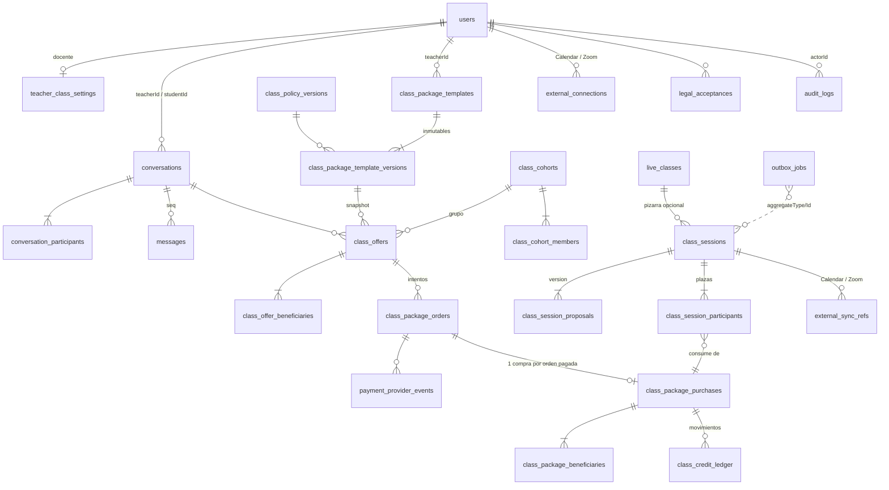

# Contrato técnico W00: clases, chat, paquetes e integraciones

Versión **1.3** · 22/10/2026 · Paquete W00 ([#13](https://github.com/aguerreroRosarioBus/SpanishNow/issues/13)) · Responsable: orquestador de turno.

Este documento convierte la [guía](SPEC.md) §13 en un contrato que los paquetes W01–W09 consumen sin renegociar. La guía manda sobre el *qué*; este contrato fija nombres, tablas, estados, invariantes, formatos y rutas. Cambiarlo exige un PR que suba la versión, actualice la tabla de cambios del final y avise en el issue «Orquestación» (#23) a los paquetes afectados.

Estado de la implementación en W00: el esquema completo (§3) existe como migración y modelos; la mecánica transversal (ledger de saldo, outbox/jobs, flags, capacidades, limpieza de cuentas de prueba, utilidades de dinero) está implementada con pruebas. Ninguna ruta de §9 existe todavía: cada paquete implementa las suyas respetando esta tabla.

---

## 1. Convenciones

### 1.1 Dinero (PACK-01)

- Importe: **entero en unidades menores** (`INT`), nunca `DECIMAL`/`FLOAT` ni texto. USD 15 = `1500`.
- Moneda: columna `currency` `CHAR(3)` con código ISO 4217 **en mayúsculas** (`USD`). Las órdenes de cursos existentes guardan minúsculas (`usd`); no se tocan, y nada mezcla importes de ambas tablas.
- Nunca se suman importes de monedas distintas: las utilidades lanzan error (`money.assertSameCurrency`).
- Prorrateos y repartos (reembolso de la parte no usada, PACK-07 §4): `money.allocate(total, pesos)` con **mayor resto** determinista; ante empate de restos gana el índice menor. La suma de partes es exactamente `total` y ninguna parte es negativa. Reembolso de *k* unidades no usadas de *n*: `money.prorate(pagado, n, k)` = parte de las *k* últimas en `allocate(pagado, [1×n])`, por lo que la suma de todos los reembolsos parciales posibles nunca supera lo pagado.
- En API: `{ "amount": 9000, "currency": "USD" }`. El cliente formatea con `Intl.NumberFormat` según su idioma; el idioma no cambia la moneda (I18N-02).

### 1.2 Tiempo (TZ-01–TZ-06, TZ-16)

- **Persistencia**: columnas `DATETIME` en **UTC**. La conexión Sequelize fija `timezone: '+00:00'` de forma explícita (`src/config/database.js`); el resultado no depende de `TZ` del proceso ni de `time_zone` de MySQL (prueba «UTC persistence» en `backend/tests/w00.foundation.test.js`).
- **API, salida**: instantes ISO 8601 con `Z` y milisegundos (`2026-10-22T13:00:00.000Z`).
- **API, entrada**: un instante se acepta solo con `Z` o desplazamiento explícito (`2026-10-22T09:00:00-04:00`). Una cadena sin zona se rechaza con `time_without_zone`. Las horas de pared se envían como *intención local* (§1.3), nunca como instante.
- **Zonas**: identificador IANA (`America/Argentina/Cordoba`) en `VARCHAR(64)`, validado con `Intl.supportedValuesOf('timeZone')` + alias que acepte `Temporal`. Prohibido `UTC-3`, `EST`, países.
- **Biblioteca**: [`@js-temporal/polyfill`](https://github.com/js-temporal/temporal-polyfill) **0.5.1** (fijada sin `^`), en backend y frontend, hasta que el runtime traiga `Temporal` nativo. Verificada al redactar este contrato con `TZ=Asia/Tokyo`: TZ-T01–T03 dan `13:00Z`, `13:00Z`, `14:00Z`; TZ-T04 lanza `RangeError` con `disambiguation: 'reject'`; TZ-T05 da `05:30Z`/`06:30Z` con `earlier`/`later`; TZ-T06 da Córdoba 22/10 23:30 y Londres 23/10 03:30; Katmandú (+05:45) correcto. `Intl.DateTimeFormat` solo para presentar. La agrega W06 (dueño de las utilidades de zona); ningún otro paquete convierte hora local a instante.
- **Duraciones**: siempre en unidades explícitas (`validityHours`, `minutes`, `leadTimeHours`). «90 días» = `2160` horas transcurridas entre instantes UTC (TZ-16). Nada de sumar «1 día» de calendario.
- **Comparaciones de plazo**: con instantes UTC y desigualdad documentada por regla. «Al menos 24 h antes» incluye el límite exacto: `startsAt - now >= 24 h` es *en plazo* (TZ-T09).
- **Intervalos**: semiabiertos `[startsAt, endsAt)`. Dos intervalos chocan si `a.start < b.end + buffer && b.start < a.end + buffer` (AGENDA-04).

### 1.3 Intención local de una sesión (TZ-05, TZ-12, TZ-13)

Toda propuesta de horario viaja y se guarda así:

```json
{
  "localStart": "2026-11-01T01:30",
  "timeZone": "America/New_York",
  "offset": "-05:00",
  "disambiguation": "later",
  "minutes": 50
}
```

- El servidor recalcula el instante con `Temporal` y `disambiguation: 'reject'`; si la hora no existe responde `local_time_nonexistent` con `params.alternatives` (instantes válidos antes/después). Si es ambigua y falta `disambiguation`, responde `local_time_ambiguous` con `params.options` (`[{ offset, startsAt }]` ×2).
- Si `offset` no coincide con el de esa zona y fecha, responde `offset_mismatch` (TZ-T08). El cliente nunca envía `startsAt` para crear o reprogramar.
- Se guardan `localStart`, `timeZone`, `utcOffset`, `disambiguation` (`none`/`earlier`/`later`), `startsAt`, `endsAt` y la `version` de la sesión.

### 1.4 Identificadores, versiones e idempotencia

- PK `INT` autoincremental (como el resto del esquema); `BIGINT` en tablas de alto volumen (`messages`, `class_credit_ledger`, `outbox_jobs`, `payment_provider_events`, `audit_logs`).
- Los IDs no dan acceso: todo recurso se autoriza por pertenencia (CONTRACT-02). Un recurso ajeno responde **404** `not_found`, igual que uno inexistente.
- Mutaciones sobre algo versionado (sesión, propuesta, plantilla) envían `version` y reciben `409 version_conflict` si no es la vigente.
- Claves de idempotencia del cliente: header `Idempotency-Key` (≤ 64, `[A-Za-z0-9_-]`, permitido en CORS) en checkout y en creación de ofertas/sesiones; `clientMessageId` en mensajes. Repetir la misma clave devuelve el mismo resultado con **200**, no un error.
- Claves internas de operación (`operationKey`, `dedupeKey`): texto determinista con el formato `<verbo>:<agregado>:<id>[:...]`, únicas en base (§4).

### 1.5 Errores (I18N-04, CONTRACT-02)

Cuerpo único, compatible con el `{ error }` existente:

```json
{ "error": "Texto en español para logs y clientes viejos", "code": "insufficient_credit", "params": { "available": 0 } }
```

El frontend traduce por `code` + `params`; `error` es solo respaldo. Catálogo en §10. Un servicio lanza un error con `statusCode`, `code` (minúsculas, estable) y `params`; el middleware común `backend/src/middlewares/error.middleware.js` responde con ese cuerpo (los `code` de Node/sistema nunca se exponen). `CreditError` ya sigue esta forma.

---

## 2. Diagrama de entidades



---

## 3. Entidades, columnas y estados

Nombres de tabla en `snake_case` plural, columnas en `camelCase` (convención del repo). Todas con `createdAt`/`updatedAt` salvo las tablas *append-only*, que solo tienen `createdAt`. Migración: `backend/migrations/20261108000000-create-classes-chat-foundation.js`. Modelos en `backend/src/models/` registrados en `models/index.js`.

### 3.1 Preferencias de usuario (W01)

Columnas nuevas en `users`: `locale ENUM('en','es') NULL`, `timeZone VARCHAR(64) NULL`, `timeZoneConfirmedAt DATETIME NULL`. `NULL` = sin elegir (se aplica el orden de I18N-01). Cambiar `timeZone` nunca modifica sesiones (TZ-04).

### 3.2 Configuración docente — `teacher_class_settings`

`userId` (PK, FK users CASCADE), `classesEnabledAt` (lo activa un admin con `class_teachers.manage`; `NULL` = el docente no aparece para consultas ni vende; §16), `acceptsInquiries BOOL`, `salesPausedAt` (pausa de ventas, PACK-05/AC21), `sessionBufferMinutes SMALLINT DEFAULT 10`, `minLeadTimeHours SMALLINT DEFAULT 24`. Esta fila es también el **cerrojo de agenda del docente** (§6.3).

### 3.3 Chat (W04)

| Tabla | Columnas clave | Unicidad / índices |
| --- | --- | --- |
| `conversations` | `teacherId`, `studentId`, `createdById`, `lastMessageSeq INT`, `lastMessageAt`, `teacherFirstReplyAt` (CHAT-07) | **UNIQUE(`teacherId`,`studentId`)**; idx (`studentId`,`lastMessageAt`), (`teacherId`,`lastMessageAt`) |
| `conversation_participants` | `conversationId`, `userId`, `role ENUM('teacher','student')`, `lastReadSeq INT` (monotónico, CHAT-10), `blockedAt`, `reportedAt`, `reportReason`, `emailNotifiedSeq INT` | **UNIQUE(`conversationId`,`userId`)**; idx (`userId`) |
| `messages` | `conversationId`, `seq INT` (asignado por servidor bajo lock de la conversación), `senderId NULL` (`NULL` = sistema), `type ENUM('text','offer','session_proposal','system_event')`, `body TEXT` (≤ 2000 en servicio), `clientMessageId VARCHAR(64)`, `offerId`, `classSessionId`, `proposalVersion`, `eventCode VARCHAR(64)`, `eventParams JSON`, `contextType ENUM('course','package','session')`, `contextId`, `hiddenAt`, `hiddenById`, `hiddenReason` | **UNIQUE(`conversationId`,`seq`)**; **UNIQUE(`conversationId`,`senderId`,`clientMessageId`)** |
| `rate_limit_buckets` | `bucketKey VARCHAR(191)`, `windowStart DATETIME`, `hits INT` | **UNIQUE(`bucketKey`,`windowStart`)**; sirve entre réplicas (CHAT-07) |

Reglas: solo el backend crea `offer`/`session_proposal`/`system_event` (`senderId NULL` para sistema). Los mensajes no se editan ni borran; moderar = `hiddenAt` + `audit_logs`. Un mensaje oculto conserva sus referencias comerciales.

### 3.4 Catálogo (W05, W02)

| Tabla | Columnas clave | Unicidad |
| --- | --- | --- |
| `class_policy_versions` | `version INT`, `rules JSON` (§5), `createdById`; inmutable | **UNIQUE(`version`)** |
| `class_package_templates` | `teacherId`, `templateKey VARCHAR(64)` (p. ej. `individual-4x50`), `status ENUM('draft','active','paused','archived')`, `currentVersionId` | **UNIQUE(`teacherId`,`templateKey`)** |
| `class_package_template_versions` | `templateId`, `version INT`, `nameEn`, `nameEs`, `descriptionEn`, `descriptionEs`, `modality ENUM('individual','group')`, `groupSize TINYINT` (1, 2, 3), `billing ENUM('per_buyer','per_group','per_seat')`, `sessionsCount`, `minutesPerSession`, `seatsCovered`, `priceAmount`, `currency`, `validityHours`, `policyVersionId`, `hotmartProductId`, `hotmartOfferCode`, `hotmartCheckoutUrl`, `expectations JSON` (SALES-01/02, W02), `createdById`; **inmutable** | **UNIQUE(`templateId`,`version`)** |

Editar una plantilla = crear versión nueva y mover `currentVersionId` (PACK-03). Las seis variantes de SPEC §3 son: `individual`/`per_buyer`/`seatsCovered=1`; `group2-1x50-total` = `group`/`groupSize=2`/`per_group`/`seatsCovered=2`/`3000`; `group3-1x50-seat` = `group`/`groupSize=3`/`per_seat`/`seatsCovered=1`/`1500`. El seed **no** las activa (§16): quedan `draft`.

### 3.5 Grupos — `class_cohorts`, `class_cohort_members` (W05/W06)

`class_cohorts`: `teacherId`, `templateVersionId`, `groupSize`, `formingDeadlineAt` (GROUP-04), `tentativeStartsAt`, `status ENUM('forming','ready','cancelled','completed')`. `class_cohort_members`: `cohortId`, `userId`, `invitedById`, `status ENUM('invited','accepted','declined','removed')`, `respondedAt`; **UNIQUE(`cohortId`,`userId`)**. Una invitación aceptada es requisito para que un segundo alumno sea beneficiario (GROUP-02).

### 3.6 Ofertas — `class_offers`, `class_offer_beneficiaries` (W05)

`class_offers`: `conversationId`, `teacherId`, `buyerId`, `cohortId NULL`, `templateVersionId`, `policyVersionId`, `replacesOfferId NULL` (**UNIQUE**: una oferta se reemplaza a lo sumo una vez), `status`, `snapshot JSON` (todo lo de PACK-11), y copias planas para consulta: `amount`, `currency`, `sessionsCount`, `minutesPerSession`, `seatsCovered`, `validityHours`, `hotmartProductId`, `hotmartOfferCode`; `sentAt`, `expiresAt`, `cancelledAt`, `cancelReason`, `idempotencyKey` (**UNIQUE(`teacherId`,`idempotencyKey`)**).
`class_offer_beneficiaries`: `offerId`, `userId`, **UNIQUE(`offerId`,`userId`)**.

Estados (PACK-14): `draft → sent → checkout_pending → paid`; terminales `expired`, `cancelled`, `replaced`. Transiciones válidas en `src/domain/classStates.js` (`OFFER_TRANSITIONS`). Una oferta con `checkout_pending` no se cancela ni reemplaza sin resolver el intento (PACK-11): se cancela la orden pendiente primero (§7.6).

### 3.7 Órdenes de paquete, intentos y eventos del proveedor (W05)

`class_package_orders` (una fila = un intento de checkout; separada de `orders` de cursos): `offerId`, `buyerId`, `amount`, `currency`, `provider ENUM('hotmart','fake')`, `status`, `checkoutRef CHAR(32)` (**UNIQUE**), `pendingOfferId` (**columna generada por MySQL** `CASE WHEN status='pending' THEN offerId END`, con índice **UNIQUE** → *un solo checkout pendiente por oferta* impuesto en base, PACK-15; nadie la escribe y no está en el modelo; por eso la FK `offerId` es `ON UPDATE RESTRICT`), `idempotencyKey`, `providerTransactionId VARCHAR(64)` (**UNIQUE**), `providerProductId`, `providerOfferCode`, `reportedAmount`, `reportedCurrency`, `buyerEmailReported`, `refundedAmount`, `paidAt`, `refundedAt`, `failedAt`, `reviewReason VARCHAR(64)`, `reviewResolvedAt`, `reviewResolvedById`.

Estados (PACK-14 + PACK-17): `pending → paid → partially_refunded → refunded`; `pending → failed`; `paid_needs_review` (pago efectivo que no se puede acreditar: oferta vencida/cancelada/reemplazada o datos que no cuadran). `paid_needs_review → paid` (acreditado tras revisión) o `→ refunded`.

`payment_provider_events`: `provider`, `eventKey VARCHAR(191)` (**UNIQUE(`provider`,`eventKey`)**), `eventType`, `providerTransactionId`, `occurredAt`, `orderId NULL`, `outcome ENUM('received','applied','ignored','needs_review','failed')`, `payload JSON` (saneado: sin hottok ni documentos del comprador), `error VARCHAR(500)`, `processedAt`.

### 3.8 Compras, beneficiarios y ledger (W05, W06)

`class_package_purchases`: `orderId` (**UNIQUE**), `offerId` (**UNIQUE**), `teacherId`, `buyerId`, `cohortId`, `templateVersionId`, `policyVersionId`, `snapshot JSON` (copia del de la oferta), `minutesPerSession`, `seatsCovered`, `status ENUM('active','paused','exhausted','expired','cancelled')`, `paidAt`, `expiresAt`, `pausedAt`, `pausedHoursUsed INT`, `cancelledAt`, `version INT` y los **saldos materializados**: `unitsGranted`, `unitsAvailable`, `unitsReserved`, `unitsConsumed`, `unitsExpired`, `unitsRefunded` (todos `INT UNSIGNED`, con `CHECK` en MySQL).
`class_package_beneficiaries`: `purchaseId`, `userId`, **UNIQUE(`purchaseId`,`userId`)**.
`class_credit_ledger` (*append-only*): `purchaseId`, `operation ENUM('grant','reserve','release','consume','expire','refund','adjust')`, `units INT UNSIGNED > 0`, `fromBucket`, `toBucket`, `operationKey VARCHAR(191)` (**UNIQUE**), `classSessionId NULL`, `actorId NULL`, `reason VARCHAR(255)`, `createdAt`.

Invariante de saldo (en `CHECK` y en el servicio): `unitsGranted = unitsAvailable + unitsReserved + unitsConsumed + unitsExpired + unitsRefunded`, todos ≥ 0. Detalle en §6.

### 3.9 Sesiones (W06)

| Tabla | Columnas clave | Unicidad |
| --- | --- | --- |
| `class_sessions` | `teacherId`, `kind ENUM('individual','group')`, `cohortId`, `status`, `version INT`, `startsAt`, `endsAt`, `timeZone`, `localStart CHAR(16)`, `utcOffset CHAR(6)`, `disambiguation ENUM('none','earlier','later')`, `minutes`, `liveClassId NULL` (pizarra opcional, SET NULL), `confirmedAt`, `cancelledAt`, `cancelledById`, `cancelReason`, `chargeWaivedReason` | idx (`teacherId`,`startsAt`), (`status`,`startsAt`) |
| `class_session_proposals` | `sessionId`, `version`, `kind ENUM('initial','reschedule')`, `status ENUM('pending','accepted','declined','expired','superseded','withdrawn')`, mismos campos de horario que la sesión, `proposedById`, `expiresAt`, `leadTimeException BOOL`, `resolvedAt` | **UNIQUE(`sessionId`,`version`)**; idx (`status`,`expiresAt`) |
| `class_session_participants` | `sessionId`, `userId`, `purchaseId NULL`, `status ENUM('invited','accepted','declined','confirmed','cancelled')`, `acceptedVersion INT`, `acceptedAt`, `attendance ENUM('pending','attended','student_no_show','teacher_no_show','excused')`, `attendanceMarkedById`, `attendanceMarkedAt` | **UNIQUE(`sessionId`,`userId`)**; idx (`userId`), (`purchaseId`) |

Estados de sesión (AGENDA-01): individual `draft → proposed → confirmed → completed`; grupo `draft → forming → proposed → confirmed → completed`; terminales `declined`, `expired`, `cancelled`, `student_no_show`, `teacher_no_show`. La propuesta pendiente **es** el bloqueo provisional del horario (AGENDA-02): para conflictos cuentan las sesiones `confirmed` y las propuestas `pending` no vencidas.

### 3.10 Integraciones (W07, W08)

`external_connections`: `userId`, `provider ENUM('google_calendar','zoom')`, `status ENUM('pending','connected','needs_attention','revoked','disconnected')`, `accountEmail`, `credentials TEXT` (cifrado con el mismo helper que `GoogleConnection`), `scopes TEXT`, `targetCalendarId`, `busyCalendarIds JSON`, `tokenExpiresAt`, `refreshLockedUntil` (refresh serializado entre réplicas, CAL-08/ZOOM-08), `oauthStateHash` (**UNIQUE**), `oauthVerifier`, `oauthExpiresAt`, `lastError`, `version`. **UNIQUE(`userId`,`provider`)**. Es independiente de `google_connections` (Drive/Classroom): desconectar una no toca la otra (CAL-01, CAL-08).

`external_sync_refs`: `sessionId`, `provider ENUM('google_calendar','zoom')`, `connectionId`, `externalId`, `calendarId`, `etag`, `syncedVersion INT`, `status ENUM('pending','ready','needs_attention','cancelled')`, `correlationKey VARCHAR(64)` (**UNIQUE**; viaja al proveedor para reconciliar tras timeout, ZOOM-04/CAL-04), `joinUrl` (solo enlace de participante), `manualJoinUrl` + `manualJoinUrlById` (contingencia ZOOM-07), `lastError`, `attempts`. **UNIQUE(`sessionId`,`provider`)**. El `start_url` de Zoom **nunca** se persiste: se pide al proveedor al momento y solo al docente (ZOOM-03). Los canales de notificación de Google los agrega W07 en su migración.

### 3.11 Outbox / jobs durables — `outbox_jobs` (CONTRACT-03/04)

`topic VARCHAR(64)`, `aggregateType` (**nombre de la tabla** del agregado: `class_sessions`, `class_offers`…; la limpieza de cuentas de prueba depende de esto), `aggregateId`, `aggregateVersion NULL`, `dedupeKey VARCHAR(191)` (**UNIQUE**), `payload JSON` (sin secretos ni texto de mensajes), `status ENUM('pending','running','done','failed','cancelled')`, `attempts`, `maxAttempts`, `runAt`, `lockedBy`, `lockedUntil`, `lastError VARCHAR(500)` (saneado), `doneAt`. idx (`status`,`runAt`), (`aggregateType`,`aggregateId`). Mecánica en §8.

### 3.12 Legal y auditoría (W02 y todos)

`legal_acceptances` (*append-only*): `userId`, `documentKey VARCHAR(32)` (`terms`, `privacy`, `refunds`, `package_terms`), `documentVersion VARCHAR(32)`, `locale`, `context ENUM('signup','checkout','update')`, `contextType`, `contextId`, `acceptedAt`. idx (`userId`,`documentKey`). Los textos versionados (`legal_documents`) los crea W02.

`audit_logs` (*append-only*): `actorId`, `impersonatedById`, `action VARCHAR(64)` (p. ej. `credits.adjust`, `message.hide`, `attendance.correct`, `payment.review`), `entityType`, `entityId`, `reason VARCHAR(500)`, `data JSON` (sin tokens ni mensajes privados), `createdAt`. idx (`entityType`,`entityId`), (`actorId`,`createdAt`). Toda acción de PACK-09, CHAT-10, PACK-20 y §16 «recuperación» escribe aquí en la misma transacción.

---

## 4. Unicidad en base (CONTRACT-01)

| Requisito | Índice único |
| --- | --- |
| Conversación por pareja | `conversations(teacherId, studentId)` |
| Mensaje por clave de idempotencia | `messages(conversationId, senderId, clientMessageId)` |
| Orden estable del servidor | `messages(conversationId, seq)` |
| Evento de proveedor procesado | `payment_provider_events(provider, eventKey)` |
| Transacción del proveedor | `class_package_orders(providerTransactionId)` |
| Checkout pendiente por oferta | `class_package_orders(pendingOfferId)` |
| Una compra por orden / por oferta | `class_package_purchases(orderId)`, `class_package_purchases(offerId)` |
| Movimiento de saldo por operación | `class_credit_ledger(operationKey)` |
| Referencia de sync por sesión y proveedor | `external_sync_refs(sessionId, provider)` y `(correlationKey)` |
| Conexión por docente y proveedor | `external_connections(userId, provider)` |
| Job por clave de deduplicación | `outbox_jobs(dedupeKey)` |
| Versión de propuesta | `class_session_proposals(sessionId, version)` |
| Participante por sesión / beneficiario por compra | `class_session_participants(sessionId, userId)`, `class_package_beneficiaries(purchaseId, userId)` |

MySQL permite varios `NULL` en un único: por eso los mensajes de sistema (`senderId NULL`) no chocan y `pendingOfferId` (generada) vale `NULL` en cuanto la orden sale de `pending`. Los índices no únicos se limitan a los filtros reales listados en §3.

---

## 5. Política comercial versionada (§4 de la guía)

`class_policy_versions.rules` es un JSON validado por `src/domain/classPolicy.js` (`validatePolicy`, `DEFAULT_POLICY_V1`). Todas las duraciones en horas o minutos enteros:

| Clave | V1 | Regla |
| --- | --- | --- |
| `validityHoursBySessions` | `{ "1": 720, "4": 2160 }` | Vigencia desde `paidAt` |
| `offerTtlHours` | `168` | Caducidad de oferta enviada |
| `proposalLeadHours` | `24` | Anticipación mínima |
| `proposalTtlHours` / `proposalCutoffBeforeStartHours` | `24` / `2` | Vence en el menor de ambos |
| `freeCancelHours` | `24` | `startsAt - now >= 24 h` = sin cargo |
| `arrivalToleranceMinutes` | `10` | |
| `maxPauseHours` / `maxPauses` | `720` / `1` | |
| `renewalSuggestWhenUnitsLeft` / `renewalSuggestHoursBeforeExpiry` | `1` / `168` | Sugerencia, nunca cobro |
| `refundWindowHours` | `336` | Ver decisión pendiente P01 |
| `remindersBeforeStartMinutes` | `[1440, 60]` | |
| `teacherBufferMinutes` | `10` | Valor por defecto de `teacher_class_settings` |
| `groupFormingMaxHours` / `groupFormingCutoffBeforeStartHours` | `168` / `2` | GROUP-04 |
| `chatLimits` | `{ newConversationsPerDay: 5, messagesPerHourBeforeReply: 10, messagesPerHourPerConversation: 60, teacherMessagesPerHourPerConversation: 120 }` | CHAT-07 |
| `chatMaxMessageLength` | `2000` | CHAT-05 |

Una oferta guarda `policyVersionId` y copia `rules` en su `snapshot`; la compra hereda ambos. Cambiar la política = nueva versión; nunca se edita una existente.

---

## 6. Contrato de saldo compartido por W05 y W06 (PACK-19, AGENDA-03, AC04)

Implementado en `backend/src/services/classCredits.js`. **Es la única puerta** para mover saldo: ningún paquete escribe `class_credit_ledger` ni los `units*` directamente.

### 6.1 Movimientos

| `operation` | De → a | Quién lo usa |
| --- | --- | --- |
| `grant` | — → `available` (y `unitsGranted += n`) | W05 al acreditar una orden pagada |
| `reserve` | `available` → `reserved` | W06 al **confirmar** una sesión (no al proponer) |
| `release` | `reserved` → `available` | W06: cancelación en plazo, ausencia/cancelación docente, expiración de grupo |
| `consume` | `reserved` → `consumed` | W06: clase dictada, ausencia alumno, cancelación tardía |
| `expire` | `available` → `expired` | Job de vencimiento (W05) |
| `refund` | `available` → `refunded` | W05: reembolso de la parte no usada, tras confirmar el proveedor |
| `adjust` | `available` ↔ `none` (±), `consumed` → `available` | Corrección con permiso `class_credits.adjust`, motivo y `audit_logs` (PACK-09, PACK-20) |

### 6.2 API del servicio

```js
const credits = require('../services/classCredits');
// Dentro de una transacción abierta por el llamador (sequelize.transaction):
await credits.apply({ purchaseId, operation: 'reserve', units: 1, operationKey, classSessionId, actorId, reason, adjust }, { transaction });
// -> { entry, purchase, replayed }  replayed=true si operationKey ya existía (no mueve nada)
await credits.balance(purchaseId, { transaction }); // { granted, available, reserved, consumed, expired, refunded }
```

- `apply` bloquea la compra (`SELECT … FOR UPDATE`), verifica idempotencia por `operationKey`, valida el movimiento y actualiza saldos y ledger en la misma transacción. Errores: `CreditError` con `code` `insufficient_credit` (409), `package_not_active` (409), `invalid_credit_operation` (400), `operation_key_conflict` (409: la misma clave con otros datos).
- `reserve` exige `status='active'`; `release`/`consume`/`refund`/`expire`/`adjust` también funcionan con la compra `paused`/`expired`/`cancelled` para poder cerrar compromisos (AGENDA-06, PACK-05).
- Pasa a `exhausted` cuando `available = reserved = 0` tras `consume`; vuelve a `active` si una corrección devuelve saldo y no venció.

### 6.3 Claves de operación (contrato)

| Movimiento | `operationKey` |
| --- | --- |
| Grant de una orden | `grant:order:<orderId>` |
| Reserva de una sesión | `reserve:session:<sessionId>:purchase:<purchaseId>` |
| Liberación | `release:session:<sessionId>:purchase:<purchaseId>:v<version>` |
| Consumo | `consume:session:<sessionId>:purchase:<purchaseId>` |
| Reprogramación tardía (PACK-21) | consumo de la original con su clave + reserva de la nueva sesión con la suya |
| Vencimiento | `expire:purchase:<purchaseId>` |
| Reembolso | `refund:order:<orderId>:<providerRefundId>` |
| Ajuste | `adjust:audit:<auditLogId>` |

Grupo de 2 (GROUP-02): **una** reserva por (sesión, compra), no por participante; la clave anterior ya lo garantiza. Grupo de 3: cada participante consume de su propia compra.

### 6.4 Orden de bloqueos al confirmar (AGENDA-03/04)

Para no producir *deadlocks* entre confirmaciones concurrentes, toda transacción de agenda bloquea en este orden y solo lo que necesita:

1. `teacher_class_settings` del docente (`FOR UPDATE`) — serializa la agenda del docente;
2. `class_sessions` de la sesión;
3. `users` de los alumnos participantes, por `id` ascendente — serializa la agenda de cada alumno;
4. `class_package_purchases` por `id` ascendente (lo hace `credits.apply`).

Dentro del lock: validar versión vigente de la propuesta, permisos, compra activa/no vencida (`endsAt <= expiresAt`), duración/modalidad compatibles, conflictos (§1.2 con buffer) y saldo; luego `reserve`, cambiar estados y encolar outbox. **Ninguna llamada externa** dentro de la transacción (AGENDA-07).

---

## 7. Cobro por Hotmart (D10, PACK-12–PACK-17)

### 7.1 Vínculo oferta ↔ producto de Hotmart

- La cuenta de Hotmart es de la escuela. Cada **versión de plantilla** se vincula a un **producto** (`hotmartProductId`) y a una **oferta de Hotmart** (`hotmartOfferCode`, el código del parámetro `off=` del link de pago) cuyo precio en Hotmart es exactamente `priceAmount`/`currency`. La URL base `hotmartCheckoutUrl` valida igual que en cursos (`https://pay.hotmart.com/...`). Un mismo producto puede tener varias ofertas (1 clase, 4 clases, grupos).
- No se puede enviar una oferta cuya versión de plantilla no tenga vínculo completo: `409 hotmart_mapping_missing`. Una «variante autorizada» con otro precio necesita su propio `hotmartOfferCode`.
- Editan el vínculo el dueño de la plantilla y quien tenga `class_packages.manage_all`. Un `hotmartProductId` no puede estar a la vez en un curso y en un paquete (validación de servicio en ambos lados: el webhook necesita saber qué es).

### 7.2 Checkout (PACK-12, PACK-15)

`POST /api/class-offers/:id/checkout` con `Idempotency-Key`:

1. Autentica; el usuario debe ser el `buyerId` de la oferta (si no, 404). Feature `class_packages` activo, docente sin `salesPausedAt`, oferta `sent`/`checkout_pending` y no vencida, Hotmart configurado (`HOTMART_HOTTOK`) o modo fake; si no, `503 payments_unavailable`.
2. Transacción con lock de la oferta: si hay orden `pending` de la oferta se **reutiliza** y devuelve la misma URL (doble clic, dos pestañas). Si no, crea `class_package_orders` (`pending`, `checkoutRef` aleatorio de 32 caracteres `[a-z0-9]`, importe y moneda **de la oferta**) y pasa la oferta a `checkout_pending`.
3. La URL es `hotmartCheckoutUrl` + `off=<hotmartOfferCode>` + `sck=<checkoutRef>` + `email`/`name` del comprador prellenados. No hay llamada al proveedor, así que no existe el caso de timeout al crear; el cuerpo de la petición se ignora salvo la clave de idempotencia.
4. El redirect de vuelta solo muestra estado (`GET /api/class-offers/:id/checkout`); **no acredita** nada (PACK-16).

### 7.3 Conciliación del webhook (PACK-13, PACK-16, AC03)

Se reutiliza `POST /api/payments/hotmart/webhook` y `verifyHottok`. `handleEvent` decide el destino **antes** de la lógica de cursos:

1. Registrar el evento en `payment_provider_events` con `eventKey` = `id` del evento de Hotmart (o `<event>:<transaction>:<status>` si falta). Si ya existía y está `applied`/`ignored`, responder 200 sin hacer nada.
2. Buscar la orden de paquete por `checkoutRef` = `sck` del webhook (`data.purchase.origin.sck`; ver 7.5). Si no hay `sck` pero `data.product.id` pertenece a una versión de plantilla, buscar por `providerTransactionId`; si tampoco, el evento queda `needs_review` (pago sin referencia: nunca se pierde, se ve en el panel de revisión).
3. Si el producto pertenece a un curso y no hay orden de paquete, sigue el flujo de cursos actual sin cambios.
4. **Aprobado** (`PURCHASE_APPROVED`/`PURCHASE_COMPLETE`), en **una** transacción con lock de la orden y de la oferta:
   - orden ya `paid`/`refunded`/`paid_needs_review` → nada (replay);
   - producto y `offer.code` del webhook ≠ snapshot, u oferta `expired`/`cancelled`/`replaced`, u orden `failed` → orden `paid_needs_review` con `reviewReason` (`offer_closed`, `product_mismatch`, `offer_code_mismatch`), outbox para avisar al docente y a `class_payments.review`, mensaje de sistema al comprador «pago recibido en revisión» (PACK-17);
   - si no → orden `paid` (`providerTransactionId`, importes reportados), oferta `paid`, compra creada con `expiresAt = paidAt + validityHours`, beneficiarios desde la oferta, `credits.apply(grant)` con `grant:order:<id>`, mensaje de sistema en el chat y outbox `email.purchase_confirmed`.
   - La identidad del beneficiario sale **de la oferta**, nunca del email de Hotmart; si el email difiere se guarda en `buyerEmailReported` y en `audit_logs`, sin bloquear.
5. **Reembolso / contracargo** (`PURCHASE_REFUNDED`, `PURCHASE_CHARGEBACK`): orden `refunded` (o `partially_refunded` si el importe es parcial), `refund` del saldo `available` con `refund:order:<id>:<eventKey>`, compra `cancelled`. Las reservas futuras quedan para que el docente las resuelva (outbox `review.refunded_with_reservations`); lo consumido no se toca. Si llega **antes** que la aprobación, la orden queda `refunded` y la aprobación posterior no acredita (igual que cursos).
6. **Cancelado / expirado** en Hotmart (`PURCHASE_CANCELED`, `PURCHASE_EXPIRED`, `PURCHASE_PROTEST` sin cobro): orden `pending` → `failed`, oferta vuelve a `sent` si no venció.
7. Cualquier evento o producto desconocido responde 200 con `handled: false` (Hotmart desactiva webhooks que fallan), dejando el evento `ignored`.

Garantías: el evento único + `providerTransactionId` único + compra única por orden + `grant:order:<id>` único hacen que webhook repetido, concurrente o desordenado produzca **una** compra y **una** acreditación (AC03). Ningún paso crea `enrollments` ni `orders` de cursos.

### 7.4 Vencimiento y cancelación de ofertas (PACK-17)

El job `offer.expire` (dedupe `offer.expire:<offerId>`, `runAt = expiresAt`) pasa la oferta a `expired` y la orden pendiente a `failed`. Hotmart no permite cerrar un link de pago: un pago posterior entra por 7.3-4 como `paid_needs_review`. Reemplazar una oferta = cancelar la anterior (y su orden pendiente) y crear otra con `replacesOfferId`; el historial muestra la anterior como `replaced`.

### 7.5 A verificar en el sandbox de Hotmart (primer paso de W05)

La documentación pública no confirma dónde llega el parámetro de seguimiento en el webhook 2.0.0. W05 debe hacer una compra de prueba en el sandbox con `sck` y `off` y registrar el payload real (sin datos personales) en `backend/tests/fixtures/`. Si `sck` no vuelve, usar `xcod`; si ninguno vuelve, la correlación pasa a ser **producto + `offer.code` + email del comprador + única orden `pending` de ese comprador para ese código**, y cualquier ambigüedad cae en `paid_needs_review`. El contrato de tablas no cambia en ningún caso.

### 7.6 Modo fake (CONTRACT-05)

Con `PAYMENTS_FAKE=1` (prohibido en producción por `config/payments.js`) el checkout devuelve una URL interna del frontend que llama a `POST /api/class-offers/:id/checkout/fake-complete`; esa ruta arma un cuerpo con la forma del webhook de Hotmart y lo pasa por **el mismo** manejador del 7.3. Así las pruebas recorren la conciliación real sin proveedor.

### 7.7 Reembolsos iniciados por la escuela (PACK-08)

Primero se registra la solicitud (`audit_logs` + outbox), después se ejecuta en Hotmart y solo el webhook de reembolso mueve saldo y estado (§7.3-5). Ver decisión pendiente **P01**: Hotmart reembolsa la transacción completa, y la regla de §4 pide prorratear.

---

## 8. Outbox y jobs durables (CONTRACT-03/04, AGENDA-07/08)

Implementado en `backend/src/services/outbox.js`:

```js
await outbox.enqueue({ topic, aggregateType, aggregateId, aggregateVersion, dedupeKey, payload, runAt }, { transaction });
await outbox.cancel({ aggregateType, aggregateId, topicPrefix, beforeVersion }, { transaction }); // invalida pendientes viejos
outbox.register(topic, async (job, ctx) => { ... });   // handler idempotente; ctx.stillOwned()
await outbox.runOnce({ workerId, limit, leaseMs });       // reclama y ejecuta de a un job
outbox.start({ intervalMs }) / outbox.stop();            // bucle del proceso (solo si OUTBOX_WORKER=1)
```

- `enqueue` se llama **dentro** de la transacción de negocio: si la transacción se revierte, el job no existe. Con un `dedupeKey` repetido no crea otro (devuelve el existente).
- `runOnce` reclama **de a un job** con `SELECT … FOR UPDATE SKIP LOCKED` (MySQL 8) entre los `pending` con `runAt <= now` y los `running` con `lockedUntil` vencido (proceso caído). Cada reclamo lleva un **token de propiedad** en `lockedBy` y un lease (`leaseMs`, 5 min por defecto) que se **renueva cada `leaseMs/3`** mientras corre el handler. El handler corre **fuera** de la transacción y recibe `ctx.stillOwned()` para verificar la propiedad antes de un efecto externo. El job se cierra solo si el token sigue siendo dueño: éxito → `done`; error → `attempts++`, `runAt` con *backoff* exponencial (30 s × 2^n, tope 6 h) y `lastError` saneado; al llegar a `maxAttempts` → `failed` (visible en métricas y panel de recuperación). Si otro worker se quedó con el job, el resultado cuenta como `lost` y no se toca la fila.
- Dos workers vivos no ejecutan el mismo job: un handler largo mantiene su lease y no retiene los demás jobs del lote. Un reinicio no pierde trabajos. `runAt` y `lockedUntil` tienen precisión de milisegundos. Los handlers deben ser idempotentes (por `dedupeKey` / versión del agregado), porque un job puede ejecutarse dos veces si el proceso muere después del efecto y antes de marcar `done`.
- Recordatorios: un job por (sesión, versión, destinatario, tipo), `dedupeKey = reminder:<sessionId>:v<version>:<userId>:<minutes>`, `runAt = startsAt - minutes`; solo se encolan los que sigan siendo futuros. Reprogramar o cancelar llama a `cancel(beforeVersion)` y el handler además descarta si `aggregateVersion` ≠ versión vigente (AGENDA-08).
- Tópicos reservados: `email.*`, `reminder.session`, `offer.expire`, `proposal.expire`, `cohort.deadline`, `purchase.expire`, `calendar.sync`, `zoom.sync`, `review.*`. Cada paquete registra los suyos.
- `setTimeout` solo como disparador del bucle, nunca como garantía (CONTRACT-04).

---

## 9. Rutas de API congeladas (§13.1)

Todas bajo autenticación salvo las marcadas *pública*/*callback*. Las rutas que crean o cambian algo van detrás del flag del módulo (§11) y con el flag apagado responden `404 feature_disabled`; las lecturas de lo ya adquirido (`GET /api/me/class-packages*`, `GET /api/class-sessions*`, historial de conversaciones existentes) y las acciones para resolver compromisos (cancelar, marcar asistencia, reembolsar) no dependen del flag. «Dueño» = paquete que la implementa. Ninguna existe todavía.

### 9.1 Preferencias — W01

| Método y ruta | Uso |
| --- | --- |
| `GET /api/me/preferences` | `{ locale, timeZone, timeZoneConfirmedAt, chatUnreadEmail }` |
| `PATCH /api/me/preferences` | `{ locale?, timeZone?, confirmTimeZone?, chatUnreadEmail? }`; `400 time_zone_invalid` |

### 9.2 Chat — W04

| Método y ruta | Uso |
| --- | --- |
| `GET /api/teachers/available` | Docentes con `classesEnabledAt` y `acceptsInquiries` (para iniciar chat) |
| `GET /api/conversations?cursor=&limit=` | Bandeja propia: contraparte, contexto, último mensaje, no leídos; `{ items, nextCursor }` (cursor opaco). El docente no ve una conversación hasta su primer mensaje |
| `GET /api/conversations/unread` | `{ conversations, messages }` no leídos, para el aviso en la navegación (CHAT-09) — *agregada en 1.1* |
| `POST /api/conversations` | `{ teacherId, context? }` → crea o devuelve la existente (200/201); `429 rate_limited`, `409 teacher_unavailable` |
| `GET /api/conversations/:id` | Detalle (solo participantes) |
| `GET /api/conversations/:id/messages?beforeSeq=&afterSeq=&limit=` | Historial por cursor `seq`, siempre ascendente; `{ items, hasMore }`. Sin cursor: los últimos `limit` (30, máx. 100) |
| `POST /api/conversations/:id/messages` | `{ clientMessageId, body, context? }`; 201 nuevo / 200 repetido; `409 conversation_blocked`, `409 operation_key_conflict` (misma clave con otro texto), `429 rate_limited`, `400 message_too_long` |
| `POST /api/conversations/:id/read` | `{ seq }` (monotónico: nunca retrocede) |
| `POST` / `DELETE /api/conversations/:id/block` | Bloquear / desbloquear |
| `POST /api/conversations/:id/report` | `{ reason }`; también bloquea desde ese lado |
| `GET /api/admin/chat/reports` | `chat.moderate`; conversaciones reportadas, sin texto de mensajes — *agregada en 1.1* |
| `GET /api/admin/chat/reports/:conversationId/messages?beforeSeq=&limit=` | `chat.moderate`; solo conversaciones reportadas; cada lectura en `audit_logs` (`chat.report_read`) — *agregada en 1.1* |
| `POST /api/admin/messages/:id/hide` | `chat.moderate`; `{ reason }`; solo mensajes de conversaciones reportadas |

Notas de W04 (1.1): el contexto (`{ type: course|package|session, id }`) viaja en cada mensaje y debe pertenecer a la pareja; el de la conversación es el del último mensaje que lo tiene. Una sesión «ingresar como» (impersonación) recibe `403 forbidden` con `params.reason = impersonation` en todo `/api/conversations*`. W05/W06 crean `offer`/`session_proposal`/`system_event` con `chatService.appendSystemMessage(conversationId, { type, eventCode, eventParams, offerId, classSessionId, proposalVersion, dedupeKey }, { transaction })`, idempotente por `dedupeKey` y sin pasar por bloqueos ni límites.

### 9.3 Catálogo y configuración docente — W05 (W02 agrega `expectations`)

| Método y ruta | Uso |
| --- | --- |
| `GET` / `PATCH /api/teacher/class-settings` | Pausa de ventas, consultas, buffer |
| `GET /api/teacher/class-packages` | Plantillas propias (`?teacherId=` con `class_packages.manage_all`) |
| `POST /api/teacher/class-packages` | Crear plantilla + versión 1 (`draft`) |
| `POST /api/teacher/class-packages/import-initial` | Importar explícitamente las seis variantes como borradores; idempotente, no pisa las existentes; `?teacherId=` solo con capacidad global |
| `GET /api/teacher/class-packages/:id` | Plantilla con versiones |
| `POST /api/teacher/class-packages/:id/versions` | Nueva versión (= editar); `{ version }` actual para `409 version_conflict` |
| `PATCH /api/teacher/class-packages/:id/status` | `{ status }` `active/paused/archived`; activar exige vínculo Hotmart |
| `GET /api/public/teachers/:id/class-packages` | *Pública*: catálogo activo con instantánea vigente |
| `GET /api/admin/class-teachers`, `PATCH /api/admin/class-teachers/:userId` | `class_teachers.manage`: activar docentes |
| `GET` / `POST /api/admin/class-policies` | `class_packages.manage_all`: versiones de política |

### 9.4 Grupos — W05

| Método y ruta | Uso |
| --- | --- |
| `POST /api/teacher/class-cohorts` | Crear cohorte (`groupSize`, `tentativeStartsAt`, invitados) |
| `GET /api/teacher/class-cohorts/:id` | Estado, miembros, `formingDeadlineAt` |
| `POST /api/class-cohorts/:id/invitation/accept` · `/decline` | El invitado responde |

### 9.5 Ofertas y checkout — W05

| Método y ruta | Uso |
| --- | --- |
| `POST /api/conversations/:id/offers` | Docente crea y envía (`Idempotency-Key`); `{ templateVersionId, cohortId?, beneficiaryIds? }`; `409 sales_paused`, `409 hotmart_mapping_missing`, `409 group_incomplete` |
| `GET /api/conversations/:id/offers` | Ofertas de la conversación (participantes) |
| `GET /api/class-offers/:id` | Detalle con snapshot (docente emisor y comprador/beneficiarios) |
| `POST /api/class-offers/:id/cancel` | Docente; `{ reason }` |
| `POST /api/class-offers/:id/replace` | Docente; crea otra con `replacesOfferId` |
| `POST /api/class-offers/:id/checkout` | Comprador; iniciar o reutilizar; `409 offer_not_payable`, `409 offer_expired`, `503 payments_unavailable` |
| `GET /api/class-offers/:id/checkout` | Estado de la orden (página de retorno) |
| `POST /api/class-offers/:id/checkout/fake-complete` | Solo con `PAYMENTS_FAKE=1` |
| `POST /api/payments/hotmart/webhook` | *Callback* existente, extendido (§7.3) |
| `GET /api/admin/class-payments?status=paid_needs_review` | `class_payments.review` |
| `POST /api/admin/class-payments/:orderId/resolve` | `{ action: 'credit' \| 'refund', reason }` |

### 9.6 Compras y saldo — W05

| Método y ruta | Uso |
| --- | --- |
| `GET /api/me/class-packages` | Compras propias (comprador o beneficiario) con saldo por cubeta |
| `GET /api/me/class-packages/:id` | Detalle, ledger y reglas compradas |
| `POST /api/me/class-packages/:id/pause` · `/resume` · `/cancel` | `409 package_not_active`, `409 sessions_pending_resolution` (PACK-07) |
| `POST /api/me/class-packages/:id/refund-requests` | Solicitud con desglose (PACK-08) |
| `GET /api/teacher/class-purchases?studentId=` | Compras de sus alumnos (para proponer) |
| `POST /api/admin/class-purchases/:id/adjustments` | `class_credits.adjust`; `{ units, direction, reason }` |

### 9.7 Agenda — W06

| Método y ruta | Uso |
| --- | --- |
| `GET /api/class-sessions?from=&to=&role=` | Sesiones propias (docente o participante) |
| `POST /api/class-sessions` | Docente propone (`Idempotency-Key`): participantes, compras, intención local §1.3 |
| `GET /api/class-sessions/:id` | Detalle con propuesta vigente y estado de sync por proveedor |
| `POST /api/class-sessions/:id/proposals` | Reprogramar: nueva propuesta (`version`) |
| `POST /api/class-sessions/:id/proposals/:version/accept` · `/decline` | Alumno; `409 proposal_stale`, `409 schedule_conflict`, `409 insufficient_credit` |
| `POST /api/class-sessions/:id/cancel` | `{ version, reason }`; respuesta incluye `charge: 'none' \| 'consumed'` |
| `POST /api/class-sessions/:id/attendance` | Docente marca asistencia por participante |
| `GET /api/class-sessions/:id/join` | Participante: `joinUrl`; docente: `hostUrl` pedido al proveedor al momento (nunca se guarda) |
| `POST /api/class-sessions/:id/sync/retry` | Docente o `class_sessions.support` |

### 9.8 Integraciones — W07 / W08

| Método y ruta | Uso |
| --- | --- |
| `GET /api/integrations/google-calendar` | Estado, cuenta, calendarios; nunca credenciales |
| `POST /api/integrations/google-calendar/connect` | Devuelve URL de autorización |
| `GET /api/integrations/google-calendar/callback` | *Callback* OAuth (state hash + PKCE) |
| `PATCH /api/integrations/google-calendar` | `{ targetCalendarId, busyCalendarIds }` |
| `DELETE /api/integrations/google-calendar` | Desconectar (no borra sesiones) |
| `POST /api/integrations/google-calendar/notifications` | *Callback* de canales push (token/resource validados) |
| `GET` · `POST …/connect` · `GET …/callback` · `DELETE /api/integrations/zoom` | Igual para Zoom |
| `POST /api/integrations/zoom/webhook` | *Callback* firmado por Zoom |

### 9.9 Legal y comercial — W02

| Método y ruta | Uso |
| --- | --- |
| `GET /api/public/legal/:documentKey?locale=` | *Pública*: versión vigente |
| `GET` / `POST /api/admin/legal-documents` · `POST /api/admin/legal-documents/:id/publish` | Edición versionada con permiso `legal.manage` (lo agrega W02) |
| `POST /api/me/legal-acceptances` | Registrar aceptación (`documentKey`, `documentVersion`, `context`) |

---

## 10. Códigos de error estables

| HTTP | `code` | Cuándo |
| --- | --- | --- |
| 400 | `validation_failed` | Cuerpo inválido; `params.fields` |
| 400 | `time_without_zone`, `time_zone_invalid`, `offset_mismatch` | §1.2–1.3 |
| 400 | `local_time_nonexistent` / `local_time_ambiguous` | TZ-12 / TZ-13 con `params.alternatives` / `params.options` |
| 400 | `lead_time_too_short` | Menos de `proposalLeadHours` sin excepción |
| 400 | `message_too_long` | > `chatMaxMessageLength` |
| 400 | `invalid_credit_operation` | Movimiento de saldo inválido |
| 401 | (existente) `{ error }` | Sin sesión |
| 403 | `forbidden` | Autenticado pero sin capacidad (solo cuando el recurso es visible para el usuario) |
| 404 | `not_found` | Inexistente **o ajeno** |
| 404 | `feature_disabled` | Flag del módulo apagado |
| 409 | `version_conflict` | Versión vieja |
| 409 | `insufficient_credit` | Saldo insuficiente |
| 409 | `package_not_active` | Compra pausada/vencida/cancelada/agotada |
| 409 | `schedule_conflict` | Choque con sesión o propuesta (con buffer) o con ocupación externa |
| 409 | `proposal_stale` | Propuesta vencida, reemplazada o ya resuelta |
| 409 | `offer_not_payable` / `offer_expired` | Oferta en estado que no admite checkout |
| 409 | `sales_paused`, `teacher_unavailable` | Pausa de ventas / docente no habilitado |
| 409 | `hotmart_mapping_missing` | Plantilla sin producto/oferta de Hotmart |
| 409 | `group_incomplete` | Grupo sin participantes/plazas confirmadas |
| 409 | `conversation_blocked` | Contacto bloqueado |
| 409 | `sessions_pending_resolution` | Pausa/cancelación con sesiones futuras sin resolver |
| 409 | `integration_not_connected` | Calendar/Zoom desconectado |
| 409 | `operation_key_conflict` | Clave idempotente reutilizada con otros datos |
| 429 | `rate_limited` | Header `Retry-After` y `params.retryAt` |
| 503 | `payments_unavailable`, `provider_unavailable` | Proveedor sin configurar o caído |

---

## 11. Flags por módulo y modos de prueba (§16, CONTRACT-05)

`backend/src/config/features.js`: `isEnabled(name)` y middleware `requireFeature(name)` (404 `feature_disabled`). Variables, todas **apagadas por defecto**:

| Flag | Módulo |
| --- | --- |
| `FEATURE_CHAT=1` | Chat (W04) |
| `FEATURE_CLASS_PACKAGES=1` | Catálogo, ofertas, compras (W05) |
| `FEATURE_CLASS_SCHEDULING=1` | Agenda (W06) |
| `FEATURE_GOOGLE_CALENDAR=1` | Calendar (W07) |
| `FEATURE_ZOOM=1` | Zoom (W08) |

Apagar un flag oculta la funcionalidad nueva (nuevas consultas, ofertas, checkouts, propuestas) pero **no** borra ni bloquea derechos adquiridos: las compras, el saldo y las sesiones confirmadas siguen visibles y resolubles (ver §9). `GET /api/features` (*pública*) devuelve el mapa para el frontend.

Modos fake: `PAYMENTS_FAKE=1` (existente) e `INTEGRATIONS_FAKE=1` (Calendar/Zoom por adaptador falso). `features.assertSafe()` hace que el proceso **no arranque** si `INTEGRATIONS_FAKE=1` con `NODE_ENV=production` o `RAILWAY_ENVIRONMENT` (igual que `PAYMENTS_FAKE` y `MEDIA_FAKE_UPLOADS`). Los correos siguen la regla existente de `MAIL_TRANSPORT`.

---

## 12. Capacidades (permisos) nuevas

En `backend/src/config/permissions.js` (catálogo). Ninguna se concede por ser `teacher`: el docente actúa sobre **sus** recursos por pertenencia, y solo si un admin lo habilitó (`classesEnabledAt`).

| Clave | Concede |
| --- | --- |
| `class_teachers.manage` | Habilitar/deshabilitar docentes para clases y chat |
| `class_packages.manage_all` | Ver y gestionar catálogo, vínculos Hotmart y políticas de cualquier docente (PACK-03) |
| `class_payments.review` | Ver y resolver pagos `paid_needs_review` y solicitudes de reembolso |
| `class_credits.adjust` | Ajustes excepcionales de saldo/vigencia con motivo (PACK-09) |
| `class_sessions.support` | Ver estado de proveedores, reintentar sync, reenviar invitación vigente (§16); no da enlace de anfitrión |
| `chat.moderate` | Ver mensajes **reportados** y ocultarlos con motivo; cada lectura queda en `audit_logs` (CHAT-02) |

Ninguna capacidad da lectura general de mensajes privados ni el `start_url` de Zoom de otro docente (AC16). Las cuentas de prueba nunca tienen permisos (regla existente).

---

## 13. Limpieza de cuentas de prueba (CONTRACT-05, AC20)

`deleteTestUsers` (`services/adminUsers.js`) se extiende así, en la misma transacción:

- **Se niega (409)** si alguna cuenta de prueba tiene relación con un usuario real en: conversaciones, ofertas, órdenes de paquete, compras/beneficiarios, sesiones/participantes o cohortes. Esos datos (mensajes y referencias comerciales) no son nuestros para borrar.
- La búsqueda y la comprobación usan **lecturas con bloqueo** (`FOR UPDATE`, una por columna indexada) dentro de la transacción de borrado: una relación con un usuario real creada en paralelo espera a la limpieza (y luego falla su FK) o es vista por ella (409). Nunca la borra el `CASCADE`.
- Si todo es entre cuentas de prueba, borra en orden de dependencias: jobs de outbox y referencias externas de sus sesiones, participantes, propuestas, sesiones, ledger, beneficiarios, compras, eventos de proveedor y órdenes de paquete, beneficiarios de oferta, ofertas, miembros y cohortes, mensajes, participantes, conversaciones, versiones y plantillas, conexiones externas, configuración docente, aceptaciones legales; los `audit_logs` se conservan con `actorId` nulo (`SET NULL`).
- Las FK nuevas hacia `users` son `RESTRICT` para datos comerciales (así un borrado accidental de un usuario real falla) y `CASCADE` solo en preferencias/configuración propias.

---

## 14. Superficies compartidas tocadas por W00

`backend/src/models/index.js` (registro y asociaciones nuevas), `backend/src/models/User.js` (`locale`, `timeZone`, `timeZoneConfirmedAt`), `backend/migrations/20261108000000-create-classes-chat-foundation.js`, `backend/src/config/permissions.js` (6 claves), `backend/src/config/features.js` (nuevo), `backend/src/config/database.js` (`timezone: '+00:00'` explícito), `backend/src/app.js` (`features.assertSafe()`, `GET /api/features`, `Idempotency-Key` en CORS y middleware de errores extraído a `middlewares/error.middleware.js`, que agrega `code`/`params`), `backend/src/server.js` (worker con `OUTBOX_WORKER=1`), `backend/.env.example` (flags), `backend/src/services/adminUsers.js` (limpieza), `backend/docs/database.md` (confirmación de rollback), `backend/tests/admin.test.js` y `migrationRunner.test.js` (catálogo de permisos y lista de migraciones), `COORDINACION.md` (decisión pendiente P01).

---

## 15. Decisiones pendientes detectadas en W00

Registradas en [COORDINACION.md](COORDINACION.md#decisiones). Ninguna bloquea el esquema; sí la implementación de reembolsos en W05.

- **P01 — Reembolso parcial con Hotmart.** §4 propone reembolsar la parte no usada prorrateada dentro de 14 días, pero Hotmart reembolsa la transacción completa y además el comprador puede pedir reembolso total dentro de la garantía del producto (mínimo 7 días). Falta decidir: cómo se devuelve una parte (fuera de Hotmart, registrada a mano; o solo reembolsos totales antes de usar clases) y qué pasa si el alumno pide el reembolso total en Hotmart después de usar clases.

---

## Cambios

| Versión | Fecha | Cambio |
| --- | --- | --- |
| 1.3 | 22/10/2026 | W05 (Codex): agrega importación explícita de catálogo en §9.3; sin cambio de esquema ni contrato de saldo. |
| 1.0 | 22/10/2026 | Primera versión (W00, Claude). |
| 1.2 | 22/10/2026 | W04 (Claude): `users.chatUnreadEmail BOOLEAN NOT NULL DEFAULT true` (migración `20261109000000-add-chat-unread-email-preference.js`) expuesto como `chatUnreadEmail` en §9.1 (CHAT-09). |
| 1.1 | 22/10/2026 | W04 (Claude): §9.2 agrega `GET /api/conversations/unread` y la lectura auditada de conversaciones reportadas para `chat.moderate`; precisa respuestas, contexto, impersonación y `appendSystemMessage`. Sin cambios de esquema. |
